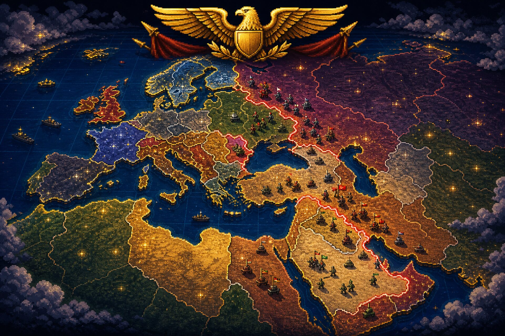

# ⚔️ CONQUEST — فتح العالم

لعبة استراتيجية حقيقية الوقت (Real-Time Strategy) بأسلوب البكسل، مستوحاة من
ألعاب الفتح مثل *Conquest.io*: تبدأ بدولة حقيقية بحدودها الحقيقية على خريطة
العالم، وتوسّع إمبراطوريتك حتى تسيطر على نسبة من الأرض.

اللعبة كاملة في المتصفح، بدون أي مكتبات خارجية (لا Three.js ولا Phaser ولا build step).



## التشغيل

```bash
cd conquest
node server.js            # http://localhost:5173
# أو أي سيرفر ستاتيك آخر:
python3 -m http.server 5173
```

> يجب تشغيلها عبر سيرفر HTTP (وليست `file://`) لأن اللعبة تستخدم ES modules.

## ما في اللعبة

**الخريطة الحقيقية**
- 236 دولة بحدود Natural Earth الحقيقية، مُحوّلة إلى شبكة بكسل (2160×840 خلية).
- خرائط جاهزة: العالم، أوروبا، آسيا، أفريقيا، الأمريكتان، أوقيانوسيا.
- أسماء الدول بالعربية، ولكل دولة عاصمتها ومستوى صعوبتها (★ إلى ★★★★★).
- أعلام مصغّرة مولّدة من رمز ISO للدولة.

**5 عصور** — من 3000 ق.م إلى 2026، لكل عصر مبانٍ وأسماء وحدات وألوان مختلفة.

**اقتصاد وبناء**
- 8 مبانٍ: مدينة، مصنع، مختبر أبحاث، ميناء، قاعدة عسكرية، مخبأ، منصة صواريخ، دفاع جوي.
- ترقية كل مبنى حتى المستوى 5 (Shift + اضغط المبنى).
- 6 مسارات بحث (أسلحة، دفاعات، لوجستيات، اقتصاد، سكان، مدفعية).

**حرب الجبهات**
- اضغط دولة مجاورة مرتين (أو ضغطة مزدوجة على الجوال) لبدء الهجوم.
- الهجوم يفتح جبهة على طول الحدود المشتركة، والجيوش تتناقص فعليًا.
- جبهة متوقفة تنتهي تلقائيًا، والمتبقي من الجيش يعود للاحتياط.
- شريط «قوة الهجوم» (Q/E) يحدد نسبة الجيش المشاركة.
- الغزو البحري بعد بناء ميناء، وصواريخ كروز وتحصين حدودي.

**دبلوماسية**
- هدنة، تحالف، هدايا، حروب، خيانة. عروض الدول تظهر لك وتقدر توافق أو ترفض.

**أوضاع اللعب**
- فتح العالم: أي دولة، بثلاثة أهداف (30% / 50% / 75% من الأرض).
- 7 حملات تاريخية: الإسكندر، روما، جنكيز خان، سقوط القسطنطينية، فتح العالم الجديد، الإمبراطورية البريطانية، نابليون — كل واحدة تبدأ بحدود الإمبراطورية التاريخية.
- التحدي اليومي: دولة وتعديل جديد كل يوم وسلسلة انتصارات.

**تقدّم وحفظ**
- رتب من مجنّد إلى إمبراطور (XP)، 19 وسامًا، حفظ تلقائي في المتصفح، ومتابعة آخر معركة.

## التحكم

| الفأرة / اللمس | لوحة المفاتيح |
| --- | --- |
| ضغطة = تحديد/هجوم | `1..8` اختيار مبنى |
| ضغطة ثانية = هجوم | `Shift` وضع متعدد / ترقية |
| ضغطة مزدوجة = هجوم (جوال) | `R` البحث |
| ضغطة يمين / ضغطة طويلة = دبلوماسية | `Q` / `E` قوة الهجوم |
| سحب = تحريك، عجلة/قرص = تكبير | `Space` إيقاف مؤقت |
| | `WASD` تحريك، `F` العاصمة، `M` بيع الجنود |

## البنية

```
conquest/
├── index.html          واجهة اللعبة (RTL، عربية)
├── styles.css          التصميم (بكسل + لوحات HUD)
├── server.js           سيرفر ستاتيك صغير (بدون تبعيات)
├── data/world-data.js  الخريطة المولّدة (شبكة + RLE + أسماء عربية)
├── js/
│   ├── main.js         الواجهة، الإدخال، الحفظ
│   ├── state.js        المحاكاة (جيوش، جبهات، دبلوماسية، أهداف)
│   ├── render.js       الرسم على Canvas (طبقة ثابتة + طبقة متحركة)
│   ├── world.js        تحميل الخريطة والألوان
│   ├── data.js         العصور، المباني، البحث، الأوسمة، التوازن
│   ├── campaigns.js    الحملات التاريخية والتحدي اليومي
│   ├── audio.js        مؤثرات صوتية مولّدة (WebAudio)
│   └── rng.js          عشوائية محسوبة
└── scripts/build_world.py   يعيد توليد data/world-data.js من Natural Earth
```

### إعادة توليد الخريطة

```bash
cd conquest
python3 scripts/build_world.py --width 2160
```

يقرأ `scripts/vendor/countries-50m.json` (Natural Earth 1:50m عبر حزمة
`world-atlas`) ويكتب `data/world-data.js` بالإضافة إلى صورة تحقق في `/tmp`.

## الأداء

- الخريطة تُرسم عبر `ImageData` بندفات كاملة (بدون `fillRect` لكل خلية).
- طبقة الخريطة الثابتة (ألوان + حدود + مبانٍ + أسماء) تُخزّن في بكسل باف، ويتحدث
  منها فقط الخلايا التي تغيّرت ملكيتها.
- الحدود الحربية نفسها مطبوعة داخل بكسل كل خلية (بدون رسم خطوط).
- المحاكاة تحتفظ بسجل تدريجي لجبهات كل دولة، فلا تعيد مسح الخريطة كل إطار.

## مصادر البيانات

- الحدود: [Natural Earth](https://www.naturalearthdata.com/) 1:50m Admin-0
  عبر [world-atlas](https://github.com/topojson/world-atlas) (رخصة ISC/Public Domain).
- الأسماء العربية: حزمة [i18n-iso-countries](https://github.com/michaelwittig/node-i18n-iso-countries) (MIT).
