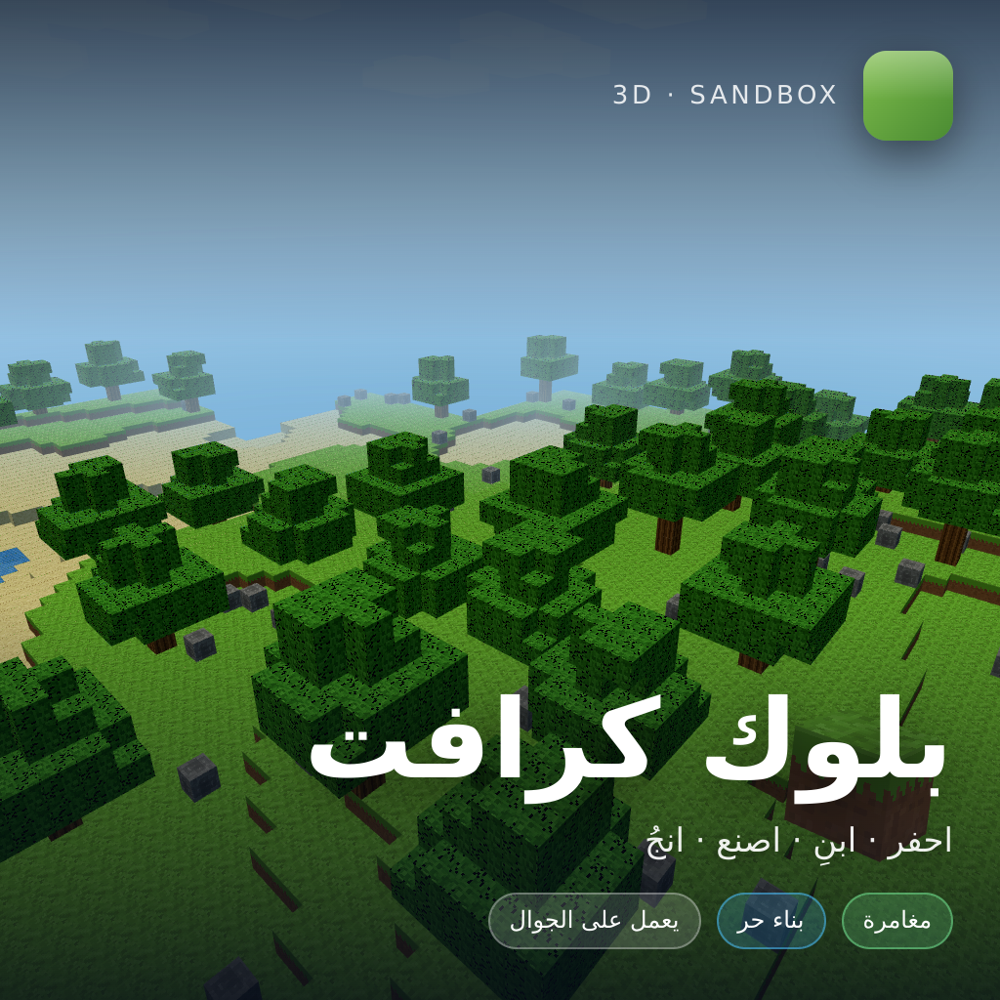

# بلوك كرافت — BlockCraft 3D 🧱

لعبة مكعبات ثلاثية الأبعاد تعمل بالكامل داخل المتصفح، مستوحاة من ألعاب مثل
`mine craft blocks` المنشورة على منصة [يلا بلاي](https://yallaplay.pages.dev/).
لا تحتاج أي خادم أو API أو تنصيب: افتح `index.html` والعب.



## المميزات

| | |
|---|---|
| 🌍 **عالم لا نهائي مولّد إجرائياً** | تضاريس بمسطحات وتلال وجبال وبحيرات، أشجار، سواحل، وقمم ثلجية — كل عالم له بصمة (seed) مختلفة. |
| ⛏️ **حفر وبناء** | اكسر أي مكعب (`زر أيسر` / زر «اكسر») وضع مكعبات (`زر أيمن` / زر «ضع») مع تحديد المكعب وارتداد اليد. |
| 🎒 **حقيبة وصناعة** | ألواح، زجاج، طوب، مصابيح، عشب — بوصفات وصناعة بضغطة واحدة. |
| 🎯 **7 مهام متتابعة** | من أول مكعب مكسور إلى بناء برج ومصباح واستكشاف 48 مكعباً؛ إكمالها يفتح شاشة الفوز. |
| 🌗 **دورة ليل/نهار كاملة** | شروق وغروب وشمس وقمر ونجوم وسحاب متحرك، مع برد ليلي يعالجك بالاقتراب من المصابيح. |
| ❤️ **نظام صحة** | سقوط من مرتفع، غرق، وبرد ليلي ينقص الصحة، مع تجدد تدريجي في النهار. |
| 🧱 **وضع بناء حر** | مكعبات لا نهائية + طيران + لا ضرر، لمن يريد البناء فقط. |
| 💾 **حفظ تلقائي** | الحفظ كل 30 ثانية وفي `localStorage`، مع زر «متابعة الحفظ» في القائمة. |
| 🕹️ **دعم الجوال** | عصا تحكم للحركة، سحب للنظر، أزرار للكسر/البناء/القفز/الجري، وواجهة تتكيّف مع الشاشة الصغيرة. |
| 🔊 **مؤثرات صوتية** | مُركّبة بـ WebAudio (بدون ملفات صوت): كسر، بناء، قفز، صناعة، فوز. |

## طريقة التشغيل

اللعبة ملفات ثابتة (static)، فتكفي أي طريقة لخدمة المجلد:

```bash
cd games/blockcraft
python3 -m http.server 4173      # أو: npx serve .
# ثم افتح http://localhost:4173
```

> ملاحظة: يجب فتحها عبر `http://` أو `https://` (لا عبر `file://`) لأنها تستخدم
> وحدات ES (`<script type="module">`).

### النشر على يلا بلاي

اضغط محتويات المجلد في ملف ZIP واحد وارفعه من صفحة النشر:

```bash
cd games/blockcraft
zip -r ../blockcraft.zip . -x 'test/*' -x 'package.json' -x 'README.md'
```

- **اسم اللعبة:** بلوك كرافت / BlockCraft 3D
- **الوصف المقترح:** عالم مكعبات ثلاثي الأبعاد — احفر، ابنِ، اصنع، وأكمل المهام.
- **التصنيف:** أكشن / مغامرات
- **الصورة:** `thumbnail.png`
- النقطة الافتراضية هي `index.html`، ولا تحتاج اللعبة أي صلاحيات أو شبكة.

## التحكم

| المفتاح | الوظيفة |
|---|---|
| `W A S D` / الأسهم | الحركة |
| `Space` | قفز (وفي الطيران: لأعلى) |
| `Shift` | جري |
| `زر أيسر` | اكسر مكعب (اضغط مطوّلاً للتكرار) |
| `زر أيمن` | ضع مكعب |
| `1` … `9` / عجلة الفأرة | اختيار مكعب |
| `E` | الحقيبة والصناعة |
| `F` | طيران (وضع البناء الحر) |
| `T` | تقديم الوقت |
| `M` | إظهار/إخفاء الخريطة المصغرة |
| `Q` | كتم الصوت |
| `Esc` | إيقاف مؤقت (وإغلاق النوافذ) |

على الجوال: العصا في يمين الشاشة للحركة، والسحب على الشاشة للنظر، والأزرار في
اليسار للكسر/البناء/القفز/الجري.

## كيف تُبنى اللعبة

```
index.html            الواجهة (HUD، القوائم، الحقيبة) + importmap لـ three
style.css             تنسيق كامل، RTL، وواجهة متجاوبة للجوال
thumbnail.png         صورة النشر
manifest.webmanifest  بيانات PWA/التثبيت
vendor/three.module.min.js   three.js r169 (نسخة محلية، بدون CDN)
src/
  main.js        حلقة اللعبة، الرسوم، ربط الواجهة، الحفظ
  world.js       توليد الأجزاء (chunks) والكتل، التعديلات، البحر والبحيرات
  mesher.js      بناء أشكال الأجزاء بحذف الأوجه المخفية + raycast للمكعبات
  blocks.js      سجل الكتل (ألوان، وجوه، صلابة، شفافية)
  player.js      الفيزياء: تصادم AABB، قفز، سباحة، صعود درجة واحدة
  sky.js         قبة السماء والشمس والقمر والنجوم والسحاب والإضاءة
  textures.js    توليد أطلس بكسلي 64×64 إجرائياً + أيقونات مكعبات مائلة
  inventory.js   المخزون وقواعد الصناعة
  quests.js      المهام وتتبّع التقدم
  input.js       لوحة المفاتيح/الفأرة/اللمس و قفل المؤشر
  audio.js       مؤثرات WebAudio المُركّبة
  util.js        أدوات مساعدة للعرض
  noise.js       ضجيج قيمي حتمي (deterministic value noise)
test/game.test.mjs  41 اختباراً لمنطق اللعبة (بدون متصفح)
```

الاختبارات:

```bash
cd games/blockcraft && node test/game.test.mjs
```

تغطي الاختبارات: توليد العالم وحتميته، وجود الماء، التصادم والقفز والسباحة
والصعود درجة واحدة، حذف الأوجه المخفية في المولّد الشبكي، تتبع الأشعة، المخزون
والصناعة، والمهام والحفظ.

### ملاحظات تقنية

- **الأداء:** الأجزاء 16×16×64 وتُبنى عند الطلب؛ الأشكال تُدمج لكل جزء مع حذف
  الأوجه الداخلية، وتُخفَّض دقة العرض تلقائياً على الأجهزة البطيئة.
- **بدون أصول خارجية:** كل الأصوات مُركّبة والنسيج يُرسم إجرائياً، والخطوط
  تعتمد على خطوط النظام العربية.
- **الوصولية:** عناصر الواجهة لها `aria-label`، والحركة تحترم
  `prefers-reduced-motion`، واللعبة تعمل باللمس أو بلوحة المفاتيح.
