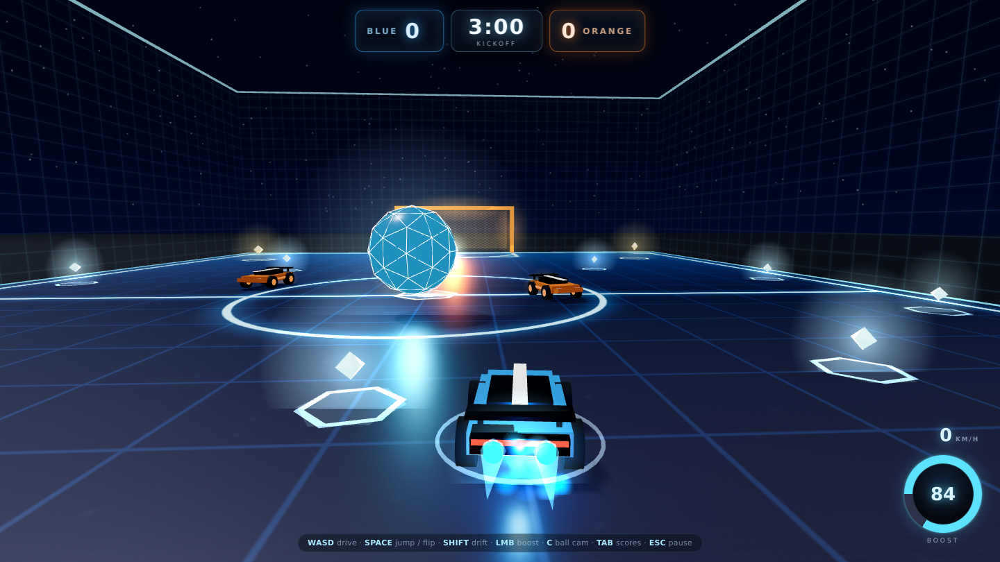

# Boostball Arena 🚗⚽

A Rocket-League-flavoured **car soccer** game that runs entirely in the browser — inspired by
[Turball.io](https://www.crazygames.com/game/turball-io-ghb).



Drive a rocket-powered car, grab boost, jump, double-jump and flip into a giant glowing ball, and
put it in the other team's goal. Play **1v1** or **2v2** against AI bots with three difficulty levels.

No build step, no backend, no network calls — three.js is vendored locally, so it works offline.

---

## Run it

```bash
cd turball
python3 -m http.server 8080
# open http://localhost:8080
```

Any static file server works (`npx serve`, `php -S`, VS Code Live Server, …).
ES modules require `http://`, so opening `index.html` with `file://` will not load.

---

## Controls

| Input | Action |
| --- | --- |
| `W` / `S` | accelerate / reverse · nose down / up in the air |
| `A` / `D` | steer · yaw in the air |
| `Space` | jump · press again for a double jump or directional flip |
| `Shift` | powerslide / drift on the ground · hold with `A`/`D` to air-roll |
| `Left mouse` | boost (hold) |
| `C` | toggle ball camera |
| `Tab` | hold to show the scoreboard |
| `M` | mute |
| `Esc` | pause / resume |
| `Enter` | start a match from the menu or the result screen |

**Touch:** on phones/tablets the game shows a virtual joystick (left thumb), plus `JUMP`,
`BOOST`, `DRIFT`, a pause button and a `CAM` toggle. Landscape is recommended.

---

## Features

- **Arcade car physics** — acceleration, grip/drift, boost (0–100), jumps, double jumps,
  directional flips, air rolls, wall sliding, car-to-car collisions.
- **Ball physics** — gravity, bounce, rolling friction, post collisions, goal detection,
  ceiling and wall rebounds.
- **A real 3D arena** — 64 × 88 m pitch, neon walls, team-coloured goals with nets, 17 boost pads
  (small + big), stars, fog, shadows, boost particles, goal explosions, shockwaves and camera shake.
- **AI bots** — they chase the ball, aim at the goal, defend, seek boost, jump and flip.
  Difficulty scales their skill, top speed, aim and boost usage.
- **Match flow** — 3:00 matches, kickoff countdowns, goal celebrations, sudden-death overtime,
  pause menu, results screen, rematch.
- **HUD** — score, clock, boost gauge, speedometer, ball-cam indicator, live scoreboard.
- **Audio** — fully procedural WebAudio engine hum, boost noise, ball impacts, pickups and goal jingle.
- **Responsive** — desktop, tablet and mobile, with graceful fallback if WebGL is unavailable.

---

## Project structure

```
turball/
├── index.html          # markup + HUD / menu / touch overlays
├── style.css           # neon UI styling
├── src/
│   ├── engine.js       # pure simulation: Car, Ball, collisions, boost pads, AI  (no DOM)
│   └── game.js         # three.js scene, rendering, camera, audio, input, match flow
├── tests/sim.mjs       # headless smoke test for the simulation
└── vendor/             # three.js r169 (MIT) + license
```

`engine.js` is completely independent of the renderer — it only uses three.js math types — which is
why the whole match can be simulated headlessly:

```bash
node turball/tests/sim.mjs
```

The test drives four bots for 90 simulated seconds and asserts that the simulation stays finite and
inside the arena, and that the bots actually score.

---

## Tuning

All gameplay numbers live at the top of `src/engine.js`:

- `FIELD` — arena size, goal size, gravity, ball radius.
- `CAR` — top speed, boost speed/acceleration/drain, jump and flip impulses, grip.
- `BOOST_PADS` — pad layout.
- `computeAIInput()` — bot behaviour and skill scaling.

Visual tuning lives in `src/game.js` (arena materials, camera offsets, particle counts) and
`style.css` (HUD).

---

## Credits

- Built with [three.js](https://threejs.org/) r169 — MIT license, see `vendor/three-LICENSE.txt`.
- Game design inspired by Turball.io / Rocket League; this is an original implementation built for
  this repository.
